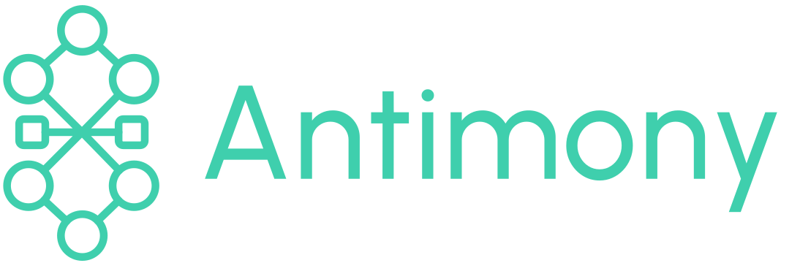
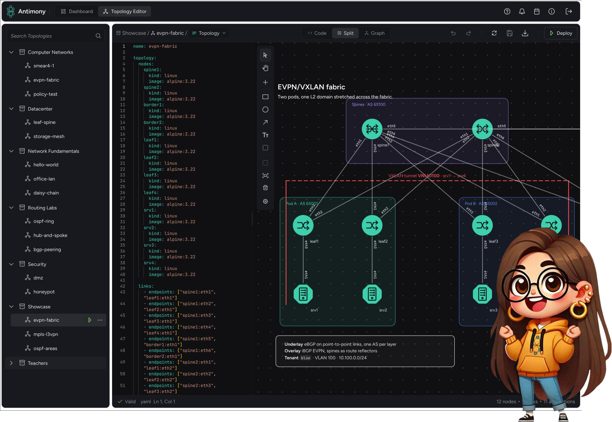

<div align="center">

<br>



<br>
<br>

**Draw the network. Antimony runs it.**

Design, deploy and operate [containerlab](https://containerlab.dev) networks from your browser.

[](https://github.com/antimony-team/antimony/actions/workflows/ci.yml)
[](https://github.com/antimony-team/antimony/actions/workflows/e2e.yml)
[](https://github.com/antimony-team/antimony/releases)
[](LICENSE)
[](https://containerlab.dev)
[](https://antimony.run/docs/deployment/desktop-app/)

**[Website](https://antimony.run)** · **[Documentation](https://antimony.run/docs/)** · **[Quick start](https://antimony.run/docs/getting-started/quick-start/)** · **[Antimony Desktop](https://antimony.run/docs/deployment/desktop-app/)**

<br>



</div>

## 🚀 Getting started

Antimony comes in two flavours. Both need a Linux machine with [Docker Engine](https://docs.docker.com/engine/install/), which runs the labs.

### On a server, for a team or a class

One command installs the latest release with Docker Compose and starts it:

```bash
curl -fsSL https://antimony.run/deploy.sh | bash
```

Open [http://localhost:8080](http://localhost:8080) and sign in with the admin password the script prints. Running the command again updates Antimony and keeps your settings.
The [quick start](https://antimony.run/docs/getting-started/quick-start/) has all options, the [Docker guide](https://antimony.run/docs/deployment/docker/) covers versions, updates and HTTPS, and [authentication](https://antimony.run/docs/deployment/authentication/) explains how to sign in with OpenID.

### On your own machine, with Antimony Desktop

Antimony Desktop is standalone: it starts its own Antimony server in Docker and signs you in, with nothing to set up. Download the package for your system from the [latest release](https://github.com/antimony-team/antimony/releases) and install it:

```bash
sudo apt install ./antimony-desktop-*.deb   # Debian, Ubuntu
sudo dnf install ./antimony-desktop-*.rpm   # Fedora
```

Every other distribution can use the AppImage: make it executable with `chmod +x` and start it. All packages come for `x86_64` and `arm64`.

More in the [Antimony Desktop guide](https://antimony.run/docs/deployment/desktop-app/).

## ✨ Features

* **Visual editor**: drag and drop nodes and links, draw shapes, lines and write text, with the containerlab YAML right next to the graph and kept in sync both ways.
* **One-click labs**: deploy a topology as one or many labs, schedule them, and follow every node's state, CPU, memory and traffic live.
* **Terminals and SSH**: open terminals to any node in the browser, or connect from your own terminal through Antimony's SSH server.
* **Logs**: stream the containerlab and container logs of a lab as they happen.
* **Made for classrooms**: collections with per-group access, sign-in through your OpenID provider, and a topology policy that keeps users' labs from reaching the server.
* **Scales out**: run labs on one Docker host, or on Kubernetes with [clabernetes](https://containerlab.dev/manual/clabernetes/).

## 📚 Documentation

Everything else is on [antimony.run](https://antimony.run/docs/): the [concepts](https://antimony.run/docs/getting-started/concepts/), the [user manual](https://antimony.run/docs/manual/dashboard/), the [configuration](https://antimony.run/docs/deployment/configuration/) and the [REST and Socket.IO APIs](https://antimony.run/docs/api/rest/).

## 🧩 Repository structure

```
antimony/
├── server/       The Antimony server, written in Go
├── interface/    The web interface and Antimony Desktop, written in React and Electron
├── site/         The website with the documentation
├── .github/      CI, end-to-end tests and releases
└── docker-compose.yml, config.yml, …   The deployment files that come with every release
```

Found a bug or have an idea? [Open an issue](https://github.com/antimony-team/antimony/issues). To work on Antimony, start with the [development setup](https://antimony.run/docs/development/setup/).

## 📄 License

Antimony is released under the [MIT license](LICENSE).
